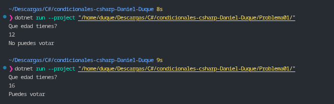

# Problema 01. Registro electoral

**Estructura elegida:** `if / else`

**Justificación:** Se utiliza una condición simple `if / else` porque solo existen dos caminos mutuamente excluyentes basados en el límite de edad para votar ($\ge 18$ o en este caso la regla definida $\ge 16$).

**Evidencia:**
