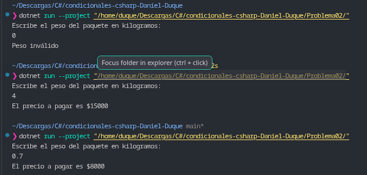

# Problema 02. Tarifa de envío por peso

**Estructura elegida:** Validación preliminar con `if / else` y cálculo con expresión `switch`.

**Justificación:** Se utiliza un `if` para filtrar los casos inválidos (pesos menores o iguales a cero) y una expresión `switch` para evaluar de manera concisa y clara los rangos continuos del peso sin caer en múltiples evaluaciones redundantes.

**Evidencia:**
