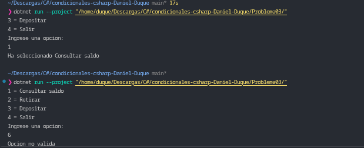

# Problema 03. Menú de cajero automático

**Estructura elegida:** Control de flujo con `switch` tradicional (`case` / `default`).

**Justificación:** Se utiliza un `switch` condicional ya que la variable de entrada evalúa valores discretos y exactos (opciones numéricas del 1 al 4) para dirigir el flujo del programa, dejando un caso `default` para capturar cualquier opción fuera de rango.

**Evidencia:**
