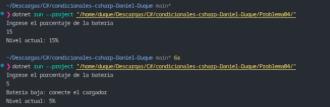

# Problema 04. Alerta de batería

**Estructura elegida:** Condicional simple `if`.

**Justificación:** Se utiliza una estructura `if` simple sin bloque `else` debido a que la alerta de batería baja es una acción condicional opcional, mientras que la impresión del nivel actual de batería es un paso incondicional que siempre debe ejecutarse.

**Evidencia:**
