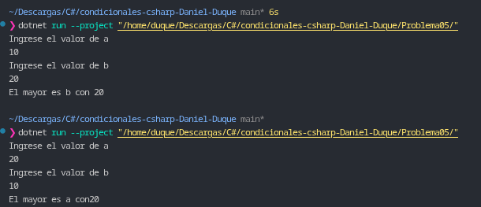

# Problema 05. El mayor de dos números

**Estructura elegida:** Operador condicional ternario (`?:`).

**Justificación:** Se utiliza un operador ternario para realizar una asignación condicional compacta en una sola línea de código, permitiendo seleccionar el valor numérico máximo entre dos variables de forma eficiente.

**Evidencia:**
