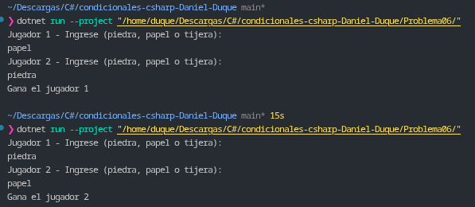

# Problema 06. Piedra, papel o tijera

**Estructura elegida:** Estrutura condicional anidada `if / else if / else` con operadores lógicos (`||` y `&&`).

**Justificación:** Permite validar primero la igualdad para resolver empates de forma inmediata, agrupando posteriormente todas las condiciones de victoria del Jugador 1 en un solo bloque lógico y delegando las victorias restantes al Jugador 2.

**Evidencia:**
