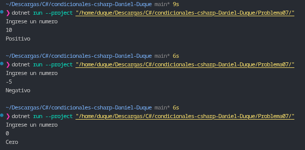

# Problema 07. Signo de un número

**Estructura elegida:** Condicional múltiple `if / else if / else`.

**Justificación:** Se utiliza una estructura condicional en cadena para evaluar tres estados mutuamente excluyentes del número ingresado: mayor a cero (positivo), menor a cero (negativo) o igual a cero.

**Evidencia:**
