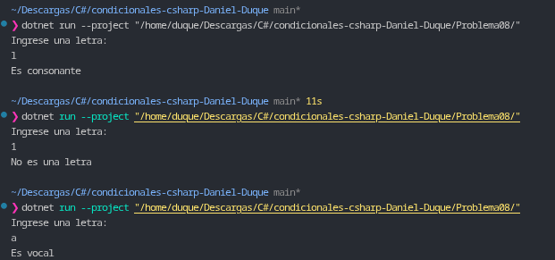

# Problema 08. Vocal o consonante

**Estructura elegida:** Condicional múltiple `if / else if / else` con operadores lógicos (`||`).

**Justificación:** Se utiliza una estructura `if` para filtrar primero caracteres no alfabéticos, un `else if` con el operador relacional `||` para agrupar la validación de las 5 vocales, y un bloque `else` final para clasificar las consonantes.

**Evidencia:**
