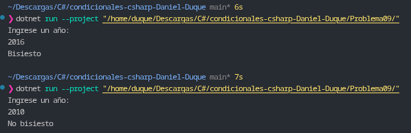

# Problema 09. Año bisiesto

**Estructura elegida:** Condicional doble `if / else` con operadores lógicos (`&&`, `||`) y operador de módulo (`%`).

**Justificación:** Se utiliza una expresión lógica compuesta que evalúa las dos condiciones del calendario gregoriano en una sola instrucción condicional: dividendo exacto entre 4 excluyendo centenarios, o dividendo exacto entre 400.

**Evidencia:**
