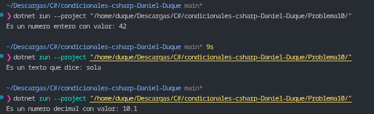

# Problema 10. Descripción de tipo de dato (`object`)

**Estructura elegida:** Evaluación de tipos con expresión `switch` (*Type Pattern Matching*).

**Justificación:** Permite inspeccionar dinámicamente el tipo subyacente almacenado dentro de una variable genérica `object` de forma directa y legible, asignando el valor a una variable fuertemente tipada en cada brazo del `switch`.

**Evidencia:**
