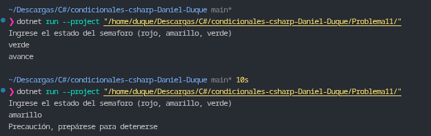

# Problema 11. Estados de un semáforo

**Estructura elegida:** Evaluación de texto mediante expresión `switch`.

**Justificación:** Se realiza una lectura directa de la cadena de texto ingresada por consola, normalizando el formato a minúsculas para evaluar los tres casos posibles del semáforo de forma directa y concisa.

**Evidencia:**
