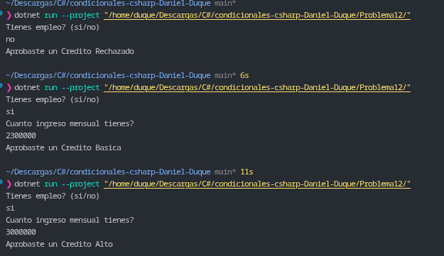

# Problema 12. Aprobación de crédito

**Estructura elegida:** Condicional anidado `if / else`.

**Justificación:** Se utiliza una estructura condicional anidada para implementar un filtro secuencial en dos niveles: primero se evalúa la condición obligatoria (tener empleo) y, únicamente si se cumple, se pasa a evaluar el rango de ingresos para determinar el nivel de crédito asignado.

**Evidencia:**
