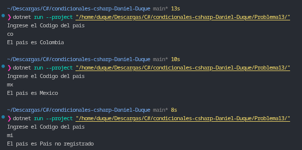

# Problema 13. Códigos de país

**Estructura elegida:** Expresión `switch` de evaluación de cadenas (*Pattern Matching*).

**Justificación:** Se utiliza un `switch` directo sobre una cadena de texto previamente normalizada en mayúsculas (`ToUpper()`), lo que permite realizar un mapeo rápido y legible de constantes de dos letras hacia el nombre completo del país correspondiente.

**Evidencia:**
