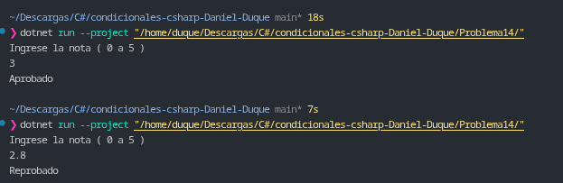

# Problema 14. Estado del aprendiz

**Estructura elegida:** Operador condicional ternario (`?:`).

**Justificación:** Se utiliza el operador ternario para llevar a cabo una evaluación directa de la nota mínima requerida (3.0) y asignar en una única línea de código el estado de aprobación correspondiente, optimizando la legibilidad.

**Evidencia:**
