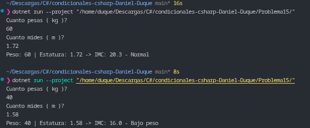

# Problema 15. Índice de masa corporal (IMC)

**Estructura elegida:** Expresión `switch` con patrones relacionales y lógicos (`<`, `>=`, `and`).

**Justificación:** Se aplica la fórmula matemática $IMC = \frac{peso}{estatura^2}$ y se evalúa el resultado decimal utilizando pattern matching relacional en un `switch`, lo que permite mapear los rangos continuos de salud de forma clara y limpia.

**Evidencia:**
