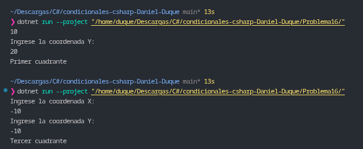

# Problema 16. Ubicación de un dron

**Estructura elegida:** Evaluación de tuplas mediante expresión `switch`.

**Justificación:** Permite agrupar las coordenadas $(X, Y)$ en una tupla para evaluarlas de forma simultánea, identificando primero las intersecciones críticas (Origen y Ejes) y categorizando posteriormente los cuatro cuadrantes cartesianos de manera concisa.

**Evidencia:**
