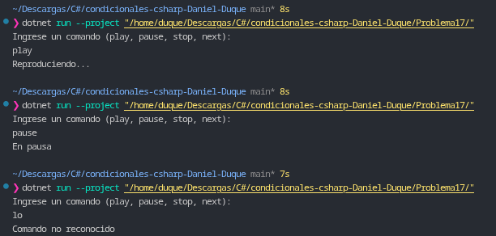

# Problema 17. Control de un reproductor

**Estructura elegida:** Expresión `switch` de evaluación de texto.

**Justificación:** Se utiliza una expresión `switch` junto con la normalización a minúsculas (`ToLower()`) para evaluar los comandos del reproductor de forma eficiente y directa, asignando la acción correspondiente o manejando un caso por defecto para entradas no válidas.

**Evidencia:**
