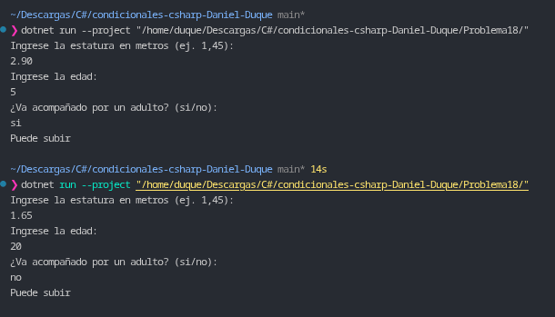

# Problema 18. Montaña rusa

**Estructura elegida:** Condicional doble `if / else` con agrupación de operadores lógicos (`&&`, `||`).

**Justificación:** Se utiliza una expresión lógica que valida obligatoriamente el filtro de estatura mínima (1.40 m) como requisito principal (`&&`), combinado con un subgrupo lógico que aprueba el acceso si se cumple al menos una de las dos condiciones de supervisión: tener 12 años o más, o ir acompañado de un adulto (`||`).

**Evidencia:**
