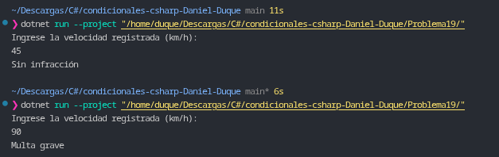

# Problema 19. Radar de velocidad

**Estructura elegida:** Expresión `switch` con patrones relacionales y lógicos (`<`, `<=`, `and`).

**Justificación:** Se utiliza pattern matching relacional sobre la velocidad medida para categorizar en un solo bloque expresivo los distintos rangos de infracción, garantizando la cobertura de límites e identificando valores erróneos mediante la primera regla.

**Evidencia:**
