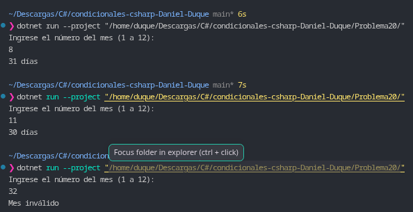

# Problema 20. Días de cada mes

**Estructura elegida:** Expresión `switch` con patrón lógico disyuntivo (`or`).

**Justificación:** Se agrupan los casos de los meses que poseen la misma duración mediante el operador `or` dentro de una expresión `switch`, simplificando la evaluación de los 12 meses del año no bisiesto y controlando de manera centralizada los valores fuera de rango con el descarte por defecto (`_`).

**Evidencia:**
