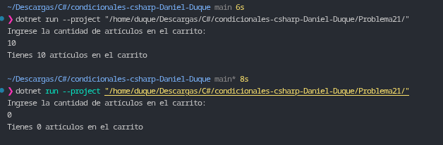

# Problema 21. Carrito de compras

**Estructura elegida:** Operador condicional ternario (`?:`) embebido en interpolación de cadenas (`$""`).

**Justificación:** Permite evaluar dinámicamente la concordancia gramatical (singular/plural) del sustantivo "artículo" en una única línea de asignación, formateando el mensaje de salida sin necesidad de duplicar la cadena base en estructuras condicionales compuestas.

**Evidencia:**
