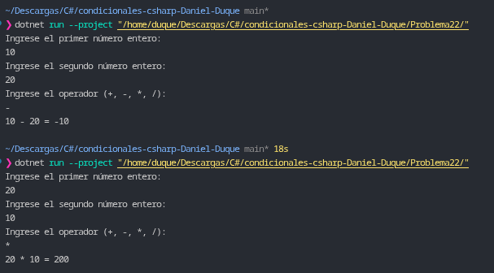

# Problema 22. Calculadora básica

**Estructura elegida:** Condicionales anidados `if / else if / else` combinados con lanzamiento de excepciones (`throw`) y control de errores con `try / catch`.

**Justificación:** Se realiza una evaluación de control de flujo imperativo tradicional para clasificar el carácter del operador y verificar el caso de división entre cero dentro de la rama correspondiente antes de realizar la operación aritmética, garantizando el manejo seguro de errores runtime mediante excepciones.

**Evidencia:**
