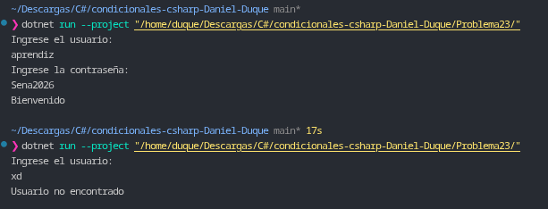

# Problema 23. Inicio de sesión

**Estructura elegida:** Condicional anidado `if / else`.

**Justificación:** Se utiliza una estructura condicional de dos niveles para realizar la autenticación secuencial: el primer nivel valida la existencia de la cuenta de usuario y, únicamente tras ser confirmada, el segundo nivel evalúa la validez de la credencial de acceso, permitiendo emitir mensajes de error específicos para cada fallo.

**Evidencia:**
