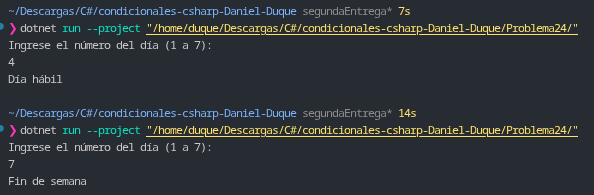

# Problema 24. ¿Día hábil?

**Estructura elegida:** Expresión `switch` con patrones relacionales y disyuntivos (`>=`, `<=`, `or`).

**Justificación:** Permite categorizar en un solo bloque conciso el rango numérico continuo de los días laborables (1 al 5) y las opciones fijas del fin de semana (6 y 7), utilizando el patrón por defecto (`_`) para controlar de forma segura cualquier entrada fuera del rango válido.

**Evidencia:**
