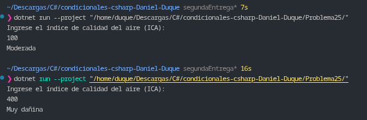

# Problema 25. Calidad del aire

**Estructura elegida:** Expresión `switch` con patrones relacionales (`<`, `<=`).

**Justificación:** Se utiliza *pattern matching* relacional para evaluar en orden secuencial los rangos del índice ICA, garantizando la detección inmediata de valores negativos no válidos y simplificando la clasificación de las categorías de calidad ambiental.

**Evidencia:**
