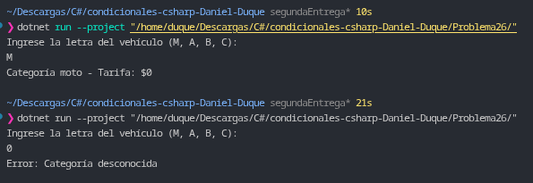

# Problema 26. Peaje

**Estructura elegida:** Expresión `switch` con lanzamiento de excepciones (`throw`) y control mediante `try / catch`.

**Justificación:** Se utiliza una expresión `switch` sobre el carácter que representa la categoría del vehículo para mapear directamente el costo del peaje e identificar entradas inválidas mediante el lanzamiento explícito de una excepción.

**Evidencia:**
