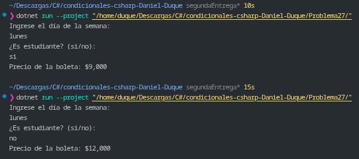

# Problema 27. Taquilla de cine

**Estructura elegida:** Expresión `switch` basada en tuplas (*Tuple Pattern Matching*).

**Justificación:** Permite evaluar simultáneamente el día de la semana y la condición de estudiante dentro de una sola estructura declarativa, clasificando las tarifas promocionales, ordinarias y de fin de semana de forma limpia y legible.

**Evidencia:**
