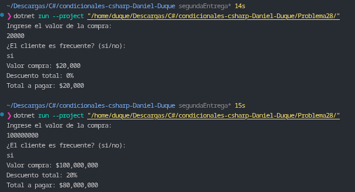

# Problema 28. Descuento por compra

**Estructura elegida:** Expresión `switch` con patrones relacionales combinada con operador condicional ternario (`?:`).

**Justificación:** Se utiliza una expresión `switch` relacional para calcular el porcentaje de descuento base según el rango del monto de compra, seguido de la adición condicional del beneficio por cliente frecuente mediante un operador ternario, garantizando un cálculo directo y preciso del total a pagar.

**Evidencia:**
