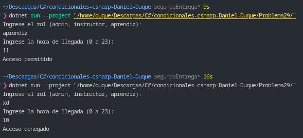

# Problema 29. Control de acceso a la sede

**Estructura elegida:** Expresión `switch` basada en tuplas con patrones relacionales y lógicos.

**Justificación:** Permite evaluar simultáneamente el rol del usuario y la franja horaria dentro de un único bloque expresivo, asignando el permiso correspondiente o denegando el acceso por defecto para combinaciones o roles no autorizados.

**Evidencia:**
