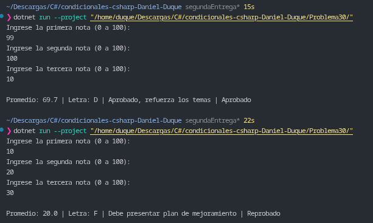

# Problema 30. Boletín de calificaciones (integrador)

**Estructura elegida:** Expresiones `switch` con patrones relacionales y disyuntivos (`>=`, `or`), combinadas con operadores ternarios e instrucciones condicionales `if`.

**Justificación:** Como ejercicio integrador, utiliza una primera expresión `switch` relacional para la conversión directa del promedio continuo a escala alfabética, una segunda expresión `switch` para la selección del mensaje pedagógico de retroalimentación, un operador ternario para definir el estado final de aprobación y una instrucción condicional `if` independiente para otorgar la distinción especial ante un rendimiento perfecto (100).

**Evidencia:**
